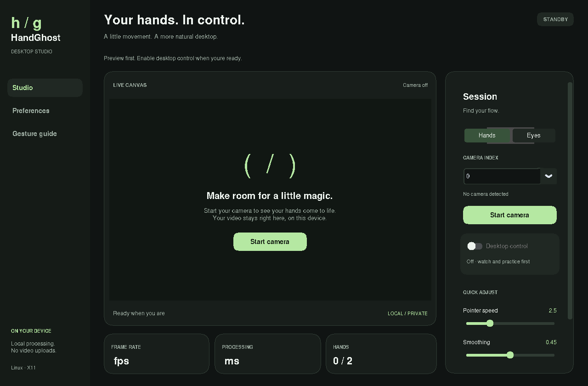

# HandGhost Studio

A local desktop controller with hand tracking and an experimental, separately calibrated eye-tracking mode. A dark studio interface provides a live preview, performance telemetry, gesture mapping, and an explicit desktop-control switch. Camera frames stay on your machine.



## Quick start

Use **Python 3.10–3.12**. MediaPipe 0.10.21 is pinned because this application uses its bundled Solutions models. Python 3.13+ and later MediaPipe releases are not supported by this version.

### Linux (X11)

On Ubuntu 22.04/24.04, install native dependencies (use a supported Python version):

```sh
sudo apt-get update
sudo apt-get install python3-venv python3-tk libgl1 libglib2.0-0
bash scripts/install.sh
bash scripts/run.sh
```

If your default Python is newer, set `PYTHON=python3.12 bash scripts/install.sh`. A webcam must be accessible to your user (typically `/dev/video0`). If permissions deny access, check your distro's camera/device policy; do not run the app as root.

**X11 supports desktop mouse/scroll input. Wayland supports camera preview and recognition only.** Sign in to an Xorg session for system-wide pointer control. Running through XWayland does not provide full Wayland desktop control. Native Wayland input portals are not implemented.

### Windows

In PowerShell with Python 3.12 installed:

```powershell
py -3.12 -m venv venv
.\venv\Scripts\python.exe -m pip install -r requirements.txt
.\venv\Scripts\python.exe main.py
```

Enable camera access for desktop apps in Windows privacy settings. Camera and pointer behavior require testing on your hardware.

## Two separate modes

**Hands:** start the camera in preview, practice the gestures, then enable **Desktop control**. Right index pinch moves the pointer, left index pinch clicks/drags, left middle pinch right-clicks, and right middle pinch scrolls as you move vertically. Change mappings and sensitivity in Preferences. Media gestures are opt-in.

**Eyes (experimental):** choose Eyes while the camera is off, start the camera, and select **Calibrate gaze · 9 points**. Keep your head steady, look at each dot, and press Space to collect about one second of samples. Calibration rejects insufficient or inconsistent samples. Then enable Desktop control to try gaze aiming. Use your normal mouse button, or optionally enable **Dwell to click**. Dwell starts off each launch; the dwell timer is adjustable in Preferences. Look away from a clicked area before clicking again. Blinks never click.

Webcam gaze is an approximation: expect coarse aiming, not pixel accuracy. Glasses, reflections, small/distant eyes, lighting, head movement, and camera placement affect results. Recalibrate after moving the camera, changing your posture, or changing screen resolution. Eye mode currently targets one desktop coordinate surface and does not handle per-monitor calibration/DPI differences. The reported calibration error is a held-out fitting estimate, not measured real-world accuracy.

Eye mode also includes a selector for **MediaPipe iris, L2CS-Net, GazeTR-Hybrid, and iTracker**. Optional models use separate local assets and per-model calibration. See [model setup and licensing](docs/models.md).

## Safety and privacy

- Desktop control and dwell clicking always start off.
- Escape pauses desktop input **while the app window is focused**. It is not a global hotkey.
- Moving your physical pointer to a screen corner activates PyAutoGUI's input fail-safe. The app pauses desktop control and releases any held drag.
- Stopping tracking, losing hands, camera failures, and normal shutdown release held buttons. Eye closure or a lost face pauses gaze input.
- Stop camera to release the device. No background camera capture before you start it.
- No cloud processing, frame recording, or frame uploads. Calibration saves only numerical coefficients.

## Preferences and diagnostics

Preferences are validated, saved atomically, and stored outside the checkout:

- Linux: `$XDG_CONFIG_HOME/handghost/settings.json` or `~/.config/handghost/settings.json`
- Windows: `%APPDATA%\handghost\settings.json`
- macOS: `~/Library/Application Support/handghost/settings.json` (not validated here)

Save preferences explicitly. Successful eye calibration is saved automatically if the directory is writable. The old repository `settings.json` is a reference; it is not modified or automatically imported. To reuse a compatible file, pass `python main.py --config /path/to/settings.json`. Invalid legacy gesture names are discarded. Desktop control is never restored automatically.

```sh
venv/bin/python main.py --diagnostics
venv/bin/python main.py --check-models
venv/bin/python -m unittest discover -v
# For GUI checks without a physical display:
HANDGHOST_TEST_DESKTOP=1 xvfb-run -a -s '-screen 0 1600x1000x24 -nolisten tcp' venv/bin/python -m unittest discover -v
```

The real pointer/button integration test requires `HANDGHOST_TEST_DESKTOP=1`; use it only inside an isolated Xvfb display.

See [validation results and limits](docs/validation.md), [model setup](docs/models.md), and [usage and troubleshooting](docs/usage.md) for camera issues and testing guidance.

## Native builds

Build **on the target OS** with Python 3.12:

```sh
python -m PyInstaller --noconfirm --clean HandGhost.spec
```

Windows produces `dist/HandGhost/HandGhost.exe`; Linux produces `dist/HandGhost/HandGhost`. Both include the hand/face/iris model data and GUI assets. CI builds also include the optional CPU PyTorch engines; research model definitions and checkpoints are installed separately using Preferences → Gaze models. Linux executables depend on the build system's glibc compatibility; use the Ubuntu 22.04 CI build for a broader Linux baseline. Distribute the entire `dist/HandGhost/` folder, including `_internal`; copying only the executable will not work. Folder bundles start without extracting the optional CPU frameworks on every launch. These are portable executable bundles, not signed installers. Windows SmartScreen/signing and Linux package formats are separate release tasks.

[CI](.github/workflows/build.yml) tests and builds Windows and Linux separately and uploads artifacts. Linux CI also verifies that the packaged app opens a window and exits cleanly. CI results are only established after the workflow runs; a local Linux build does not validate Windows.

### GitHub Releases

Pushing a version tag such as `v1.0.0` runs both native builds and automatically publishes a GitHub Release after both succeed. Merging a PR alone does not publish a release. After merging, tag the desired commit on `main`:

```sh
git switch main
git pull --ff-only origin main
git tag v1.0.0
git push origin v1.0.0
```

Use a new version for each release. Tags containing a hyphen, such as `v1.0.0-beta.1`, publish as prereleases. The workflow uploads both archives to a draft before publishing, and supports retrying failed runs for the same tag.

Download `HandGhost-Windows-X64.zip` or `HandGhost-Linux-X64.tar.gz` from the repository's **Releases** page. Extract the entire archive and run `HandGhost/HandGhost.exe` on Windows or `HandGhost/HandGhost` on Linux. The Linux tar archive preserves executable permissions. Each archive has a `.sha256` checksum file. Optional research model assets are installed separately in the app; they are not redistributed in these downloads.

## Implementation

One paced background worker owns capture, model inference, and input dispatch. The UI consumes the latest frame from a single-slot mailbox, so slow rendering cannot accumulate stale frames. Hand mode uses MediaPipe's lite model at a default 640×480 / 30 fps, with palm-relative pinch thresholds, hysteresis, and two-frame activation. Eye mode runs the face/iris model and the selected optional appearance backend, fits a regularized calibration model, smooths gaze, and requires fresh open-eye observations before aiming. FPS and processing time are measured live; processing time is not a camera-to-screen latency measurement.
